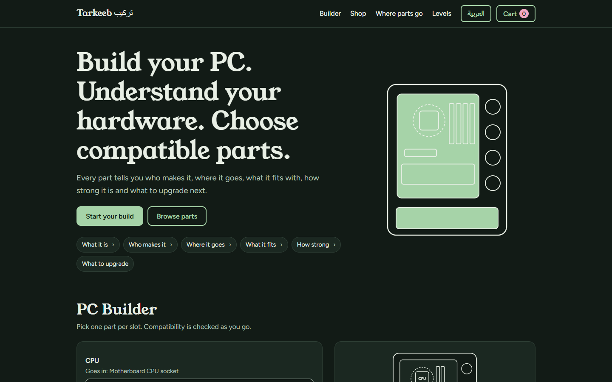
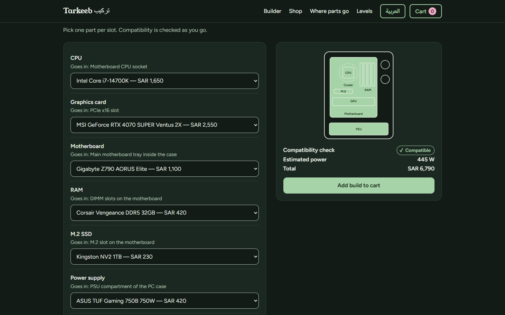
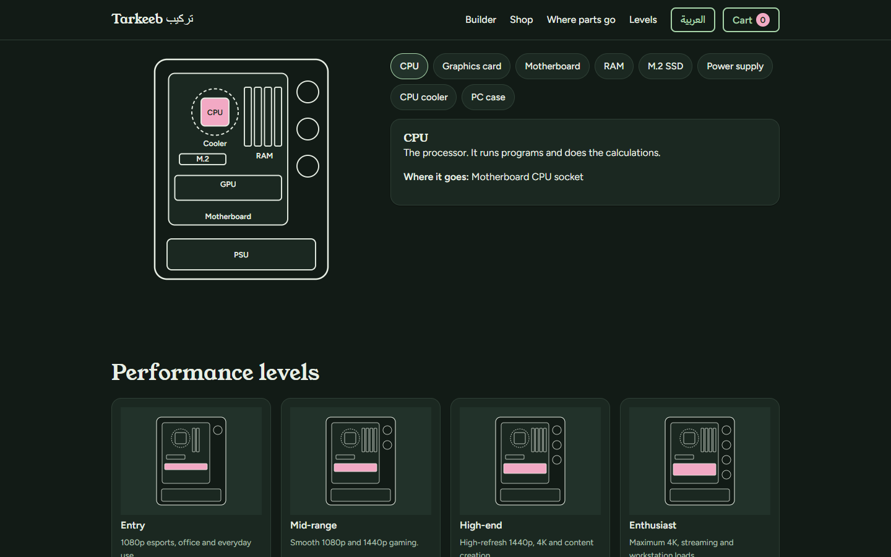
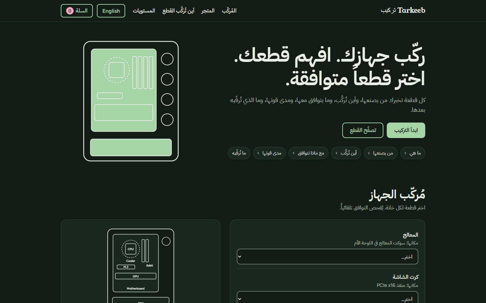
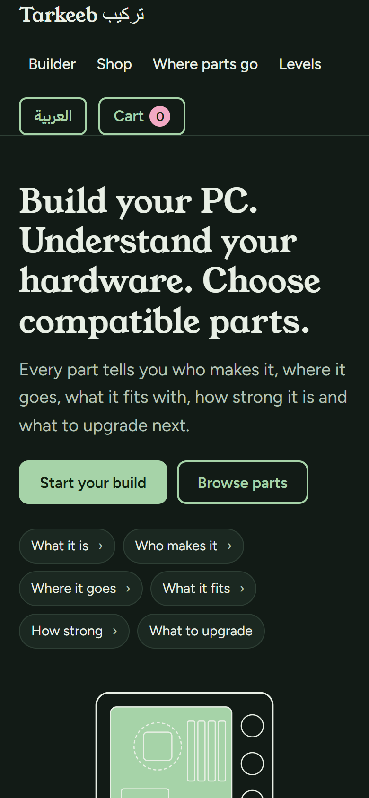

**A PC hardware platform that helps you understand every part and build a computer that works together.**

  

[English](#english) · [العربية](#arabic)

## About

Choosing PC parts is confusing: which processor fits which motherboard, how much power the build needs, and what to upgrade next. **Tarkeeb** (تركيب, "assembly") answers that in one place. Every part tells you who makes it, where it goes in the case, what it fits with, how strong it is, and what to upgrade next.

I built it in the **AI Development Program (Pathy × IBM eyouth)**, exploring how IBM Bob and AI tools are changing the way solutions are built.

## Features

- **PC Builder:** pick one part per slot; compatibility, estimated power and the total price in SAR update as you go
- **Upgrade recommendations:** suggestions for what to improve next in your build
- **Browse by part:** processors, graphics cards, motherboards, memory, storage, power supplies, coolers and cases, with specifications, compatible parts and alternatives
- **Shop and cart:** add single parts or your whole build to the cart
- **Where parts go:** an interactive diagram of the inside of a PC that shows where each part is installed
- **Performance levels:** from entry to enthusiast, explained in plain words
- **Two languages:** switch between English and Arabic, with a full right-to-left layout

## Screenshots

<table>
<tr>
<td width="50%"></td>
<td width="50%"></td>
</tr>
<tr>
<td width="50%"></td>
<td width="50%" align="center"></td>
</tr>
</table>

## Run it

No installation and no build step. Download the repository and open **`Tarkeeb — Build your PC.html`** in any modern browser.

## Author

**Abdulaziz Al-Matrafi**, Software Engineering student at Umm Al-Qura University.
[LinkedIn](https://www.linkedin.com/in/abdulaziz-al-matrafi-bbb238358/) · [GitHub](https://github.com/I4zln)

---

## عن تركيب

اختيار قطع الكمبيوتر محيّر: أي معالج يناسب أي لوحة أم، وكم يحتاج الجهاز من الطاقة، وما الذي يستحق الترقية بعد ذلك. **تركيب** يجيب عن هذا كله في مكان واحد؛ كل قطعة تخبرك من يصنعها، وأين تُركَّب، وما يتوافق معها، ومدى قوتها، وما الذي تُرقّيه بعدها.

بنيته ضمن **برنامج تطوير الذكاء الاصطناعي (Pathy × IBM eyouth)**، لاستكشاف كيف تغيّر أداة IBM Bob وأدوات الذكاء الاصطناعي طريقة بناء الحلول.

## المزايا

- **مُركِّب الجهاز:** اختر قطعة لكل خانة، ويتحدّث فحص التوافق والطاقة المتوقعة والسعر الإجمالي بالريال مباشرة
- **اقتراحات الترقية:** ما الذي يستحق التحسين بعد ذلك في جهازك
- **تصفّح القطع:** المعالجات وكروت الشاشة واللوحات الأم والذاكرة والتخزين ومزودات الطاقة والمبرّدات والصناديق، مع المواصفات والقطع المتوافقة والبدائل
- **المتجر والسلة:** أضف قطعة واحدة أو جهازك كاملًا إلى السلة
- **أين تُركَّب القطع:** رسم تفاعلي لداخل الجهاز يوضّح مكان كل قطعة
- **مستويات الأداء:** من الفئة الأساسية إلى الاحترافية بكلمات بسيطة
- **لغتان:** بدّل بين العربية والإنجليزية، مع واجهة كاملة من اليمين إلى اليسار

## التشغيل

لا يحتاج تثبيتًا. نزّل المستودع وافتح الملف **`Tarkeeb — Build your PC.html`** في أي متصفح حديث.

## صاحب المشروع

**عبدالعزيز المطرفي**، طالب هندسة البرمجيات في جامعة أم القرى.

